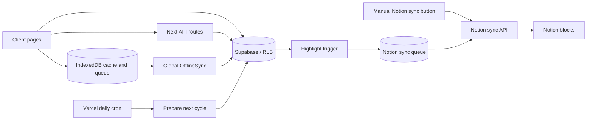

# Freedwise codebase map

Source review: 2026-11-02, starting at `753d4ce` with subsequent local fixes and
filtered PDF export. This describes the checked-out source,
not a verified production schema or deployment. Companion notes:
[review/offline behavior](REVIEW_AND_OFFLINE.md) and
[observed gaps](OBSERVATIONS.md).

## Product and runtime

Freedwise stores rich-text highlights, groups them with categories and explicit
links, and distributes the active library over configurable review cycles.
Users review Low/Med/High, browse historical days, review ahead, pin highlights,
import from Notion, push edits back to Notion, search by words or meaning, explore
a relationship graph, and merge near duplicates. It has a service worker and
offline review support, plus an iOS Scriptable widget.

This is one Next.js App Router application, not a monorepo. Most interactive
pages are large client components that directly use Supabase. API route handlers
perform scheduling, search, Notion operations, widget reads, and selected
maintenance operations. There is no ORM or separate application server.

Versions resolved in `package-lock.json` at review time:

| Dependency | Version | Role |
| --- | --- | --- |
| Next.js | 14.2.35 | App Router, route handlers, middleware |
| React | 18.3.1 | Client UI |
| TypeScript | 5.9.3 | Strict project type checking |
| Supabase JS / SSR | 2.89.0 / 0.8.0 | PostgREST, Auth, cookies, Realtime |
| Notion SDK | 2.3.0 | Page/block import and export |
| transformers.js | 2.17.2 | Browser embeddings |
| Vitest | 2.1.9 | jsdom and React regression tests |

Tailwind 3 and `app/globals.css` provide styling; Lucide provides icons;
`date-fns` supplies date utilities; `d3-force` drives the canvas graph. Sentry
is optional. Package ranges in `package.json` are broader than resolved versions.

## Directory map

| Location | Responsibility |
| --- | --- |
| `app/` | 19 pages, 25 API routes, OAuth callback, root layout, styles/error UI |
| `components/` | Editor, banners, header, sync UI, and print-export launcher |
| `lib/` | Domain logic, filtering/printing, persistence, conversions, clients |
| `hooks/` | Six hooks for debounce, embeddings, offline status, unsaved changes |
| `types/database.ts` | Manually maintained Supabase table types and UI interfaces |
| `supabase/` | SQL schema/migrations, triggers, policies, search and scheduling RPCs |
| `__tests__/` | Unit/component regressions, including review-page/widget resume |
| `public/` | Service worker, PWA manifest/icon, Scriptable widget source |
| `scripts/backfill-embeddings.mjs` | Administrative embedding backfill |

`@/*` maps to the repository root. Vitest mirrors this alias. There is no checked-in
CI workflow, Supabase CLI project configuration, or browser E2E harness in the
reviewed inventory. SQL migrations are documented as manually applied scripts.

## Runtime boundaries



The global layout mounts `ServiceWorkerRegistrar`, `OfflineSync`,
`DiscardedChangesBanner`, `TutorialModal`, `AppHeader`, and `SyncBanner`.
It loads Inter via `next/font/google`, publishes PWA metadata, and writes an IANA
timezone cookie named `tz`. No current source reader of that cookie was found.

`NotionSyncProcessor` is **not mounted** in the current source. The manual
`NotionSyncButton` is mounted on Highlights and Settings, not in the global
header. Do not infer background Notion processing from the component's existence.

## Page map

| Route | Main implementation and behavior |
| --- | --- |
| `/` | Quick add, categories, blank-line splitting, duplicate nudge, navigation cards |
| `/highlights` | Library CRUD, text/rating/count/category filters, sorting, archived toggle, filtered Print / PDF, split, pins, bulk actions; `?focus=<highlightId>` jumps to a card |
| `/highlights/recent` | Paginated edit logs with block and word diffs |
| `/daily` | Calendar, selected day, rating/clear, edits/splits, bulk actions, offline cache, lazy schedule creation |
| `/review` | One-highlight review; today then catch-up; `?ahead=1` adds a frozen future sequence; widget URL actions |
| `/archives` | Server-paginated archived library; unarchive/delete and bulk actions |
| `/pins` | Pin board, assignment-date tags, unpin/archive/delete; maximum ten pins |
| `/search` | Default semantic/hybrid search; Exact substring mode; archived toggle; result mutations and library deep links |
| `/web` | Canvas/d3-force graph, category/text filters, pan/zoom, explicit link toggles |
| `/merge` | Similarity thresholds 85/90/95%, keep-both dismissals, editable transactional merge |
| `/import` | Notion credential prefilling, preview, normalized-HTML dedup, insert batches of ten |
| `/settings` | Notion credentials/enablement; review frequency/enablement/reset; previous-cycle stats and ledger repair |
| `/widget-auth` | Issue/copy widget token and revoke all old tokens |
| `/login` | Google OAuth through Supabase |
| `/auth/auth-code-error` | OAuth failure instructions |
| `/help` | Product rules; useful context, but verify against implementation |
| `/about`, `/privacy`, `/terms` | Static informational/legal pages |

`/daily`, `/review`, and `/highlights` each contain roughly 2,000–2,700 lines.
Mutation handlers are repeated across page components; there is no centralized
query cache or global state-management package. Shared domain helpers are the
best starting point for changes, but check all relevant page handlers too.

## Data model and database responsibilities

| Table | Meaning and significant constraints |
| --- | --- |
| `highlights` | User-owned plain text, HTML, source/author, archive state, aggregates, Notion markers, embeddings |
| `categories` | User-owned category names/colors; name unique per user |
| `highlight_categories` | Unique `(highlight_id, category_id)` |
| `highlight_links` | Unique directed storage pair, no self-link; product treats links as undirected |
| `daily_summaries` | User/date container, unique `(date, user_id)` |
| `daily_summary_highlights` | Scheduled appearance and nullable Low/Med/High rating, client `rated_at`; unique `(daily_summary_id, highlight_id)` |
| `highlight_months_reviewed` | Reviewed ledger; unique `(highlight_id, month_year)` where month means cycle start |
| `user_review_settings` | Frequency and review enabled flag, one row per user |
| `review_ahead_order` | Array of highlight IDs, one row per user/cycle |
| `pinned_highlights` | User/highlight pin and timestamp; trigger checks ten-pin limit |
| `user_notion_settings` | Per-user integration token, page ID, enabled flag |
| `notion_sync_queue` | Add/update/delete payloads, original content, claim/status/retry metadata |
| `user_widget_settings` | Revocable widget-token version |
| `highlight_edit_logs` | Text/HTML edit snapshots; 90-day retention logic |
| `highlight_merge_dismissals` | Canonically ordered pairs intentionally kept separate |

Highlights have generated fields:

- `text_hash`: MD5 of trimmed, lowercased, whitespace-collapsed text. Unique
  `(user_id, text_hash)` enforces deduplication, including archived highlights.
- `score`: character length after stripping HTML tags from nonempty HTML,
  otherwise text. Scheduling queries fetch `id, score` rather than all content.
- `embedding` is a 384-dimensional pgvector column; `embedding_hash` is a stored
  MD5 of the raw text used for inference, distinct from dedup's normalized hash.

Most relationships cascade when a highlight is deleted. The Notion queue
deliberately has no cascading highlight FK: deletion must leave export work alive.
Delete queue items use saved text/HTML and can have a null highlight ID.

RLS scopes direct tables to `auth.uid()` and junctions via owned parents. Check the
specific policy when introducing a write; not every table has identical checks.
Scheduling/search/merge RPCs use `SECURITY INVOKER`. Notion enqueue and edit-log
triggers use `SECURITY DEFINER` with fixed search paths in their migrations.

Database logic includes Notion enqueueing/coalescing, generated score/hash,
edit snapshots/logs, pin-limit enforcement, resurface stats, and transactional
schedule/merge writes. Rating averages and auto-archival are recomputed in
TypeScript, not by a general rating trigger. See the companion review notes.

## API map

Paths below are under `/api`. Most handlers create the cookie-backed server
client and explicitly call `auth.getUser()`; noted exceptions need separate care.

| Path | Methods | Contract |
| --- | --- | --- |
| `daily/assign` | POST | `{year, month, fromDate?}`: replace cycle's unrated layout while preserving rated rows |
| `daily/redistribute` | POST | `{highlightIds?, localDate?, debugLastDay?}`: additive placement; no wholesale rebalance |
| `daily/apply-frequency` | POST | `{frequency, localDate?}`: compute new layout and atomically persist frequency/ledger/schedule |
| `daily/set-enabled` | POST | `{enabled, localDate?}`: flag toggle; on enable, remove entirely unreviewed expired-cycle days |
| `daily/reset-cycle` | POST | `{localDate?}`: remove current cycle history and ledger; caller separately assigns |
| `daily/prepare-next-cycle` | GET | Secret-authenticated service-role cron; daily UTC run; seven-day lead window |
| `review/next` | GET | Browser cookie or Supabase Bearer auth; `date`; resume next unrated today using rating timestamps |
| `review/widget` | GET | Signed `token`, optional local `date`; service-role read; shared forward-resume rule, today then current-cycle catch-up |
| `widget-token` | GET, DELETE | Issue token / increment token version to revoke |
| `pins` | GET, POST, DELETE | List, `{highlightId}` pin, `?highlightId=` unpin |
| `search` | POST | `{query, type, embedding?, includeArchived?}`; Exact or hybrid ranking |
| `highlights/similar` | POST | `{embedding}`: up to three draft matches at cosine >= .87 |
| `highlights/[id]/related` | GET | Explicit links plus five semantic neighbors at cosine >= .85 |
| `highlights/merge-suggestions` | GET | Pairs >= .85; per-highlight neighbor cap five; missing RPC returns setup error 501 |
| `web/graph` | GET | Whole active library and weighted edges; `?refresh=1` bypasses five-minute per-process cache |
| `embeddings/pending` | GET | Up to 100 stale/missing active vectors and remaining count |
| `embeddings/update` | POST | Validate up to 200 `{id,text,embedding}` records, call write-back RPC |
| `notion/import` | POST | `{pageId, notionApiKey}`: fetch/convert preview; no handler-level Auth check |
| `notion/sync` | GET, POST | Queue counts / process at most one ready item with per-user saved settings |
| `notion/add` | POST | Direct append using per-user settings; no current UI caller found |
| `notion/update` | POST | Legacy direct update using environment credentials; no current UI caller, no explicit Auth check |
| `stats/reviewed-count` | GET | `cycle=YYYY-MM` or legacy `month`; previous cycle by default |
| `stats/reviewed-count/repair` | POST | Backfill missing cycle ledger entries and conditionally remove spurious current-cycle entries |
| `migrate-text-fields` | POST | User-scoped maintenance: rewrite plain text from stored HTML |
| `health` | GET | No-store `{ok:true}`; heartbeat uses HEAD, handled by Next's GET fallback |

There is no generic highlight CRUD API. Most CRUD, category writes, explicit
links, and the `merge_highlights` RPC are called directly from the browser.

## Highlight content lifecycle

`RichTextEditor` uses `contentEditable`, saved selections for mobile toolbar
actions, `document.execCommand`, and custom list manipulation. It emits both text
and cleaned HTML. `lib/liftListItem.ts` preserves neighboring list items when
removing or changing a bullet/number; test its DOM behavior when editing this area.

Adding on Home or Highlights splits blank lines via `splitHtmlByBlankLines`,
generates UUIDs before the write, updates the UI optimistically, then upserts with
`onConflict: 'user_id,text_hash', ignoreDuplicates: true`. Returned IDs identify
which pieces actually saved. Categories and scheduling are follow-up operations.
A synchronous ref prevents double submission during the initial auth lookup.
An ambiguous insert failure rechecks the generated UUIDs before restoring the form.

Interactive splitting uses `parseIntoParagraphs` and `groupParagraphsByDividers`.
The original highlight keeps the first group and its history; later groups become
new highlights with copied metadata/categories and new schedule placement.
Offline split actions retain fixed IDs so retries can avoid duplicate inserts.

`renderHighlightHtml` normalizes paragraph structure and calls `sanitizeForRender`
(DOMPurify). `sanitizeHtml` only strips formatting noise and is not an XSS sanitizer.
DOMPurify currently passes through during SSR, relying on user content loading
after mount. Moving user HTML into server rendering needs revisiting this contract.

Explicit links are stored in lexicographic ID order by `canonicalPair` and
`linkHighlights`; `normalizeLinks` combines inbound and outbound reads.
`unlinkHighlights` deletes either historical orientation. Related cards and graph
links and search results use this shared logic.

`lib/highlightFilters.ts` shares filtering and sorting between the library and
print export. `HighlightPrintButton` opens a preview tab during the click gesture,
then `lib/highlightPrint.ts` fetches all owned matches in stable batches without
vectors/history. It sanitizes rich text, escapes metadata, and creates a document
with print CSS. The preview's button opens the browser print dialog (Save as PDF).
This exports saved server data, not unsaved editors or pending offline changes.

Recent edits use `highlight_edit_logs`, not just `previous_text` on a highlight.
`highlightDiff.ts` reuses Notion's block normalization, pairs changed blocks, and
builds escaped word diffs. Retention purges a user's old logs when a new edit is
logged; there is no scheduled retention job in `vercel.json`.

## Notion integration

Import and export are different workflows. Import fetches a user-specified page,
splits on empty top-level paragraphs, preserves nested lists, skips toggle blocks,
and returns a preview. The browser inserts selected preview data with
`imported_from_notion: true` so it is not echoed back as an add. Reimport performs
normalized-HTML duplicate checks; it is not a continuous bidirectional reconciler.

Export is triggered by highlight database writes while the user's Notion settings
are enabled. Inserts enqueue adds except imported rows. Text/HTML edits enqueue
updates unless `notion_optout_marker` changed. Ratings/archive-only updates do not
enqueue exports. Deletes either cancel a fresh pending add or enqueue a deletion
with retained content. The newer coalescing migration folds edits into pending
updates, fresh adds, or failed updates while preserving the original matching text.

`addToNotionSyncQueue` is only an event notification. Actual export happens through
POST `/api/notion/sync`, driven by the manual button in the mounted UI:

1. Authenticate, read per-user settings, reset claims older than two minutes.
2. Select the oldest ready item and claim pending/failed -> processing.
3. Convert HTML to blocks or find old blocks by normalized content.
4. Apply the Notion operation, mark completed, and complete superseded updates.
5. On failure, schedule retry; ordinary errors consume a five-attempt budget.
   Exhausted 429 handling reschedules with a 20-second cooldown without consuming
   an attempt. Manual drain can wait for short cooldowns.

Notion updates/deletes match content rather than stored permanent block mappings.
`notionBlocks.ts` groups blocks by empty paragraphs, compares exact normalized
content first, then leading blocks with at least half the shorter sequence aligned.
Updates delete/recreate matching top-level blocks, retaining their location when
possible; nested children are appended recursively by `appendBlocksDeep`.
Add retries inspect whether previous attempts committed fully or partially.
Update retries may reappend if the original text no longer matches.

`notionClient.ts` reserves per-token send slots 350 ms apart within a process,
honors Retry-After, and bounds rate-limit retries. Its gate is not shared across
serverless processes. Route `maxDuration` for queued sync is 60 seconds.

## Embeddings, search, graph, and merges

`clientEmbeddings.ts` lazily loads quantized `Xenova/gte-small`, mean pools and
L2-normalizes 384-dimensional vectors. Input strips HTML and collapses whitespace.
Model initialization is shared per page; a failed initialization can be retried.
Inference runs in the browser. Next's webpack config excludes Node-only sharp/
onnx dependencies from those bundles and externalizes transformers on the server.

`useEmbeddingSync` runs on Search, Web, and Merge mounts. It fetches 100 pending
rows at a time, embeds in chunks of eight, posts vectors, and repeats up to 60
passes. Write-back hashes the exact original text so concurrent edits leave a
detectable mismatch. New vectors are not guaranteed immediately after every save.
The administrative backfill script operates across the service-role-visible
library and performs real writes; it was inspected, not run.

Exact search uses escaped PostgREST ILIKE filter syntax across text/HTML, capped
at 50 results. Semantic search calls `search_highlights_hybrid_v2`: cosine and
English-stemmed lexical candidates are combined by reciprocal rank fusion
(`k=60`, 60 candidates per arm, 30 results, cosine floor .75). Missing model uses
the lexical arm. The v2 SQL scopes archives before ranking. If v2 is missing,
active searches use the older hybrid/vector RPCs and archive-inclusive searches
use ILIKE with a keyword-fallback indicator. The new SQL migration must be applied
to enable archive-inclusive semantic ranking. History uses configured cycle keys.

The graph uses its own score, not search RRF: 70% rescaled embedding cosine
(floor .78) plus 30% IDF-weighted word overlap; missing vectors use words alone.
Each node contributes its strongest four edges above .22, deduplicated across
pairs. Computation is O(n²); the API caches per user for five minutes and rereads
explicit links on every request. The browser handles simulation and canvas drawing.

Merge suggestions use nearest-neighbor pairs plus a separate Jaccard word score.
Dismissals are persistent canonical pairs. `merge_highlights` atomically unions
categories/links, transfers the removed row's pin when appropriate, deletes the
removed highlight, then updates the survivor. Deleting first avoids a text-hash
collision with the removed row. Only the survivor's review history remains;
the removed row's history cascades away. The UI defaults to keeping the older row.
The draft warning is separate: after 30 characters and an 800 ms pause, it can
append a draft to an existing highlight; it does not create a second row to merge.

## Authentication, widget, and configuration

`lib/supabase/client.ts` adds a default 15-second fetch abort and combines it with
the manual-offline abort signal. `lib/supabase/server.ts` adapts Next cookies.
The middleware refreshes sessions with a four-second fetch bound and eight-second
overall deadline. Unreachable Auth passes through with original cookies preserved;
normal anonymous access redirects to login. This fail-open behavior makes route
Auth and RLS important independent boundaries.

The middleware excludes static assets and bypasses `/api/daily/prepare-next-cycle`
and `/api/review/widget`, which authenticate independently. Login, auth, terms,
and privacy prefixes are allowed anonymously. Health's handler has no auth check,
but it still passes through middleware. About/help are not on the anonymous list.

Widget tokens are HMAC-SHA256 `userId.version.expiry.signature`, valid for 90 days.
Legacy three-part tokens map to version 1. The widget endpoint verifies signature,
expiry, and the current DB token version before a service-role read. DELETE token
bumps the version. Signing prefers `WIDGET_TOKEN_SECRET`, falling back to the
service-role key; changing that key invalidates existing signatures.

`public/freedwise-widget.js` is Scriptable source, not browser JavaScript. It stores
the token in iOS Keychain, reads the widget API, and links rating/archive/delete/pin
actions to the authenticated `/review` page. Its `APP_URL` is hardcoded and needs
changing for another deployment. The signed widget endpoint itself only reads.
`reviewQueue.ts` and `reviewResume.ts` align its next-card selection with page
reloads. API responses are no-store; the script uses a cache-busting query and
requests a refresh after five minutes. iOS controls the actual redraw schedule.
Users must replace their installed Scriptable script to receive script changes;
the API resume fix only requires deploying the app. See the review/offline notes
for same-device navigation versus server-synced rating progress.

| Environment variable | Use |
| --- | --- |
| `NEXT_PUBLIC_SUPABASE_URL` | All Supabase clients |
| `NEXT_PUBLIC_SUPABASE_PUBLISHABLE_KEY` | Preferred public client key |
| `NEXT_PUBLIC_SUPABASE_ANON_KEY` | Fallback public key name |
| `SUPABASE_SERVICE_ROLE_KEY` | Cron, widget read, administrative backfill, signing fallback |
| `CRON_SECRET` | Required cron Bearer authentication; query-secret compatibility also exists |
| `WIDGET_TOKEN_SECRET` | Optional separate signing secret |
| `NEXT_PUBLIC_SENTRY_DSN` | Enable error reporting/client-server-edge initialization |
| `SENTRY_AUTH_TOKEN` | Enable source-map uploads in wrapped builds |
| `NOTION_API_KEY`, `NOTION_PAGE_ID` | Legacy direct-update route only in current app source |

The normal Notion integration uses per-user settings, not global environment
tokens. README's `NOTION_SOURCE` / `NOTION_AUTHOR` and automatic daily-import setup
have no corresponding current application reader/job. `vercel.json` contains only
the prepare-next-cycle job, scheduled `0 0 * * *` (UTC).

## Migrations and local verification

`supabase/schema.sql` intentionally raises an exception because the obsolete schema
was unsafe. `migration_complete.sql` contains core tables, RLS, old Notion enqueue,
review settings/order, widget versioning, resurface triggers, scheduling RPCs, and
Realtime publication. It does **not** contain all later feature migrations;
the migration README now documents this. Consult [observations](OBSERVATIONS.md) before
bootstrapping or rerunning it; source review did not apply any SQL.

Run from the repository root, with dependencies installed:

```sh
rtk npm run dev
rtk npm test
rtk proxy npx --no-install tsc --noEmit --incremental false
rtk npm run lint
rtk npm run build
```

The initial review passed **253 tests in 38 files**. After the fixes and export,
the suite, TypeScript, lint, and production build pass; see the observations and
root working notes for the latest count. Tests use jsdom, Testing Library, mocked
Supabase builders/network behavior, and some source-level assertions. Middleware
tests also use the real Supabase client against mocked fetch behavior. These are
not live database/RLS/Notion integration tests.

Chrome also generated a synthetic print fixture PDF: 24 highlights, 13 pages,
rich text/Unicode preserved, and a long passage continuing across pages. This
was not an authenticated end-to-end browser session. Production build succeeded
with warnings about Browserslist data age and Sentry/OpenTelemetry's dynamic
require. No SQL migration, database backfill, or live Notion action was performed.
TypeScript excludes tests/config/setup files; Vitest execution is a separate check.

When changing a subsystem, use its regression tests and the test map in
[REVIEW_AND_OFFLINE.md](REVIEW_AND_OFFLINE.md), then update these notes when the
architecture or behavioral contract changes.
